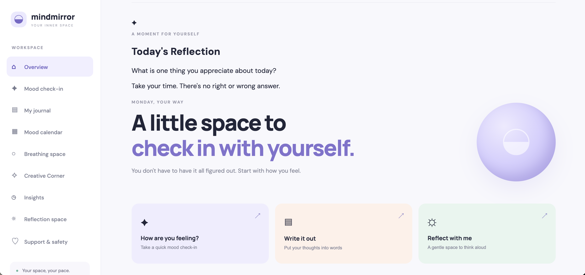
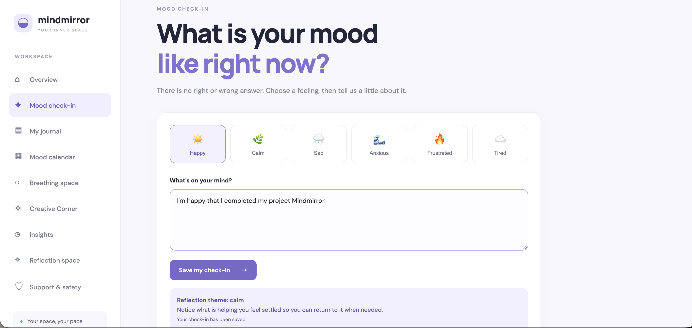
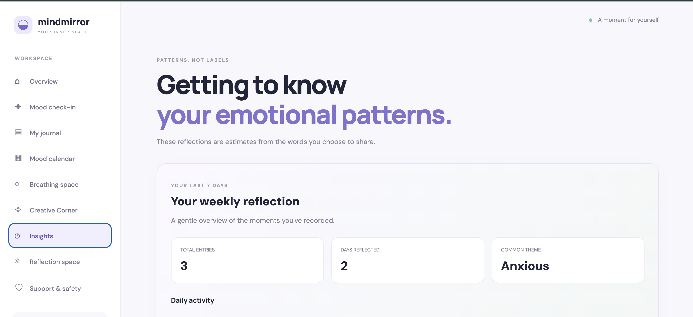
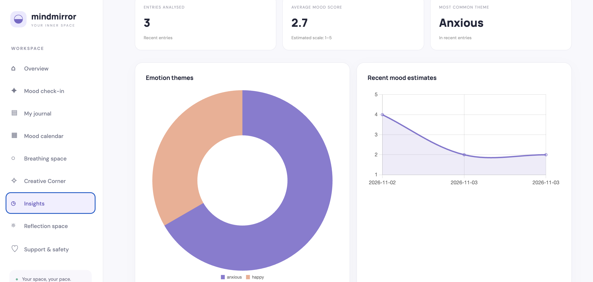
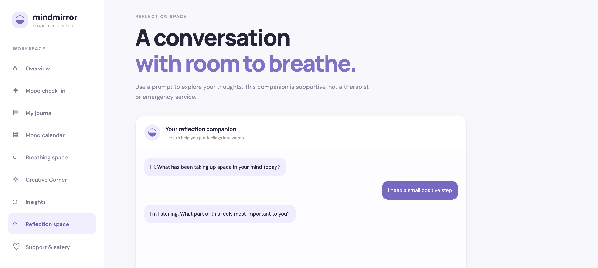
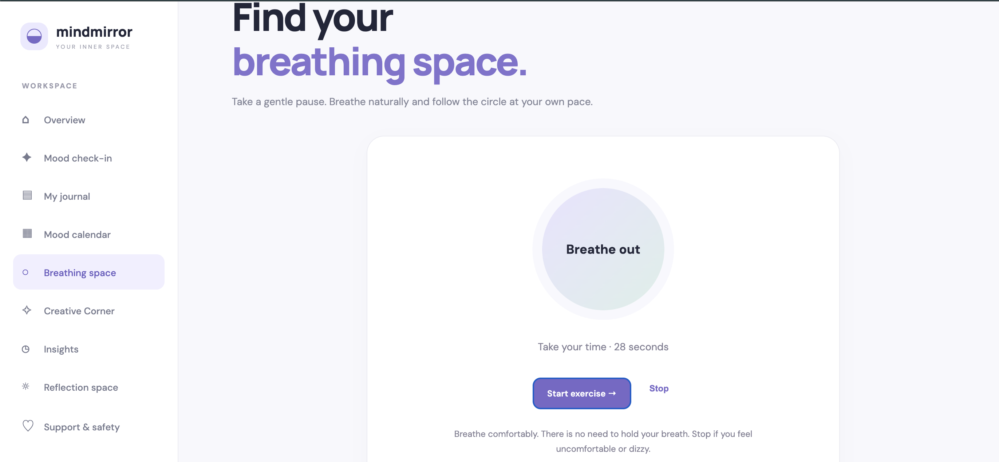
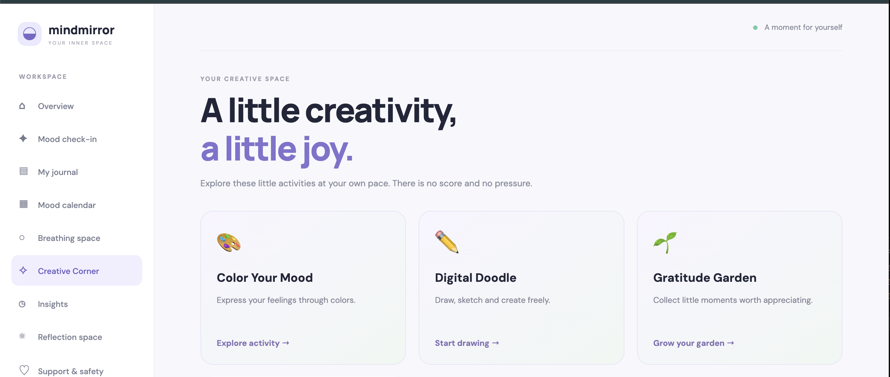
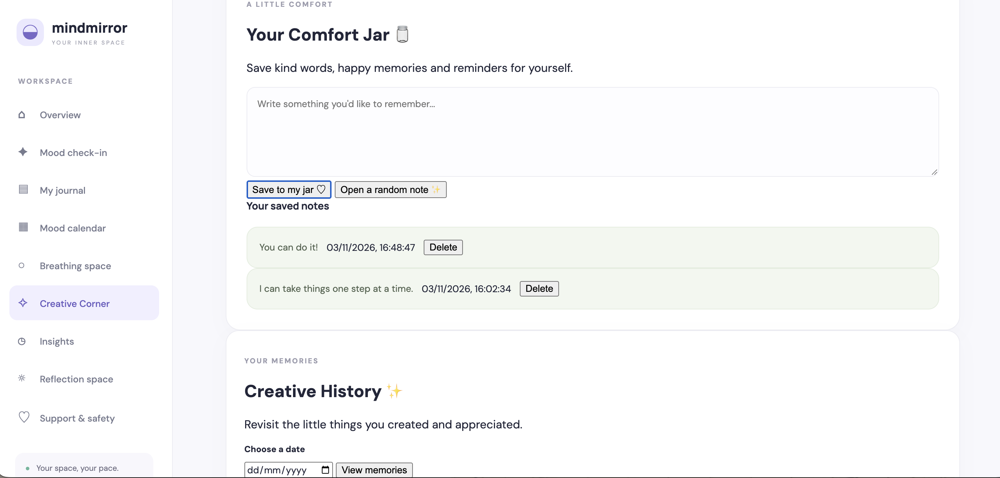
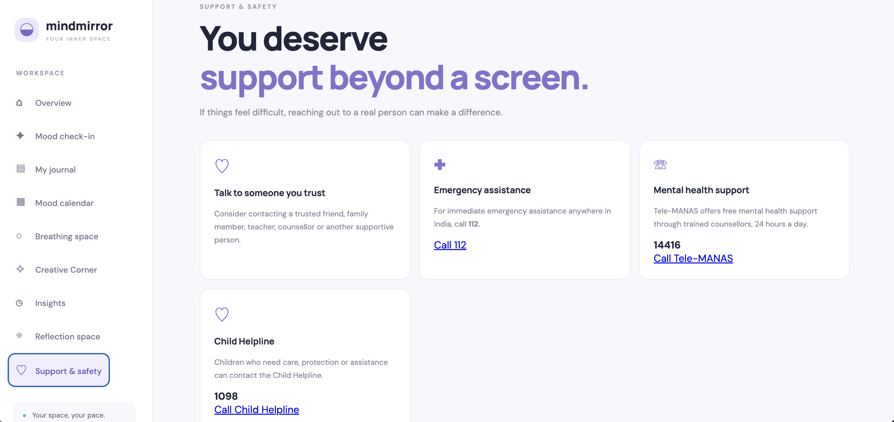

# 🌷 MindMirror
### Your Space to Pause, Reflect & Understand Yourself.

<p align="center">
  A web-based emotional wellness and self-reflection platform designed to help users understand their moods, express their thoughts, and build emotional awareness.
</p>

---

## 🏆 Hackathon Details

| Detail | Information |
|---|---|
| Problem Statement | HI-05 – Mental Health Screening & Crisis Detection |
| Team Name | HackHer |
| Participation | Solo |
| Developer | Sakina Kazmi |
| Project | MindMirror |

**Live Demo:** https://mindmirror-tbso.onrender.com/  
**GitHub Repository:** https://github.com/kazmis19/MindMirror

---

## 💡 About the Project

Emotional well-being is an important part of everyday life, but people may find it difficult to recognise their emotions, reflect on their experiences, or identify patterns in their moods.

**MindMirror** is a simple and interactive platform that provides a personal space for emotional check-ins, journaling, guided reflection, and creative expression.

It aims to encourage self-awareness through accessible tools while providing information about support resources when needed.

## 🎯 Problem Statement – HI-05

**Mental Health Screening & Crisis Detection**

MindMirror addresses this challenge through:

- Rule-based emotion estimation from user inputs.
- Mood tracking and personal journaling.
- Reflection prompts to encourage self-awareness.
- Basic detection of predefined crisis-related phrases.
- Access to support and safety information.

The platform is designed as a self-reflection and awareness tool, not as a replacement for professional mental health assessment.

---

## ✨ Features

### 1. Mood Check-in
Record your current mood and express how you are feeling through a simple check-in.

### 2. Reflection Space
Write down your thoughts and use guided reflection questions to explore your feelings.

### 3. Mood Calendar
View your recorded mood entries and observe patterns over time.

### 4. Reflection Companion
An emotion-aware, rule-based companion that responds to user inputs and encourages reflection.

### 5. Insights Dashboard
Explore mood statistics, emotional patterns, and weekly reflection summaries.

### 6. Guided Breathing
A simple guided breathing activity to encourage mindful pauses.

### 7. Creative Corner
Express emotions through interactive activities:
- Color Your Mood
- Digital Doodle
- Gratitude Garden
- Comfort Jar

### 8. Creative History
Revisit saved creative activities and gratitude entries.

### 9. Support & Safety
Find relevant support information and helpline details.

---

## 📸 Screenshots

### Overview


### Mood Check-in


### Insights Dashboard




### Reflection Space


### Guided Breathing


### Creative Corner


### Comfort Jar


### Support & Safety


---

## 🛠️ Tech Stack

| Category | Technologies |
|---|---|
| Backend | Python, FastAPI |
| Frontend | HTML5, CSS3, JavaScript |
| Database | SQLite |
| Server | Uvicorn |
| Data Validation | Pydantic |
| Development Tools | VS Code, Git, GitHub |
| Deployment | Render |

### Python Libraries

- FastAPI
- Uvicorn
- Pydantic
- SQLite3
- Datetime
- Regular Expressions (`re`)

---

## ⚙️ How It Works

MindMirror follows a simple client-server architecture.

1. The user interacts with the frontend.
2. JavaScript sends requests to the FastAPI backend.
3. The backend processes the input and estimates emotions using predefined rules.
4. User entries are stored in an SQLite database.
5. The frontend displays reflections, mood insights, and saved entries.

---

## 🚀 Installation & Setup

Follow these steps to run MindMirror locally.

### Prerequisites

- Python 3.12 or later
- Git
- VS Code (recommended)

### Step 1: Clone the Repository

```bash
git clone https://github.com/kazmis19/MindMirror.git
```

### Step 2: Navigate to the Project Folder

```bash
cd MindMirror
```

### Step 3: Create a Virtual Environment

```bash
python3 -m venv .venv
```

### Step 4: Activate the Virtual Environment

For macOS/Linux:

```bash
source .venv/bin/activate
```

For Windows:

```bash
.venv\Scripts\activate
```

### Step 5: Install Dependencies

```bash
pip install -r requirements.txt
```

### Step 6: Run the Application

```bash
python3 -m uvicorn main:app --reload
```

### Step 7: Open in Browser

Visit:

```text
http://127.0.0.1:8000
```

The application should now be running locally.

---

## 🤖 AI Tools Used

**ChatGPT**

Used as a development assistance tool for:
- Understanding implementation approaches.
- Debugging and resolving coding issues.
- Structuring application features.
- Improving documentation.

**Important:** MindMirror does not currently integrate a live ChatGPT or other LLM API. Its emotion estimation and companion responses are based on predefined rules.

---

## 📊 Model Accuracy & Performance

MindMirror currently uses rule-based emotion estimation and predefined phrase matching rather than a trained machine learning model.

Therefore:

- No trained-model accuracy is claimed.
- Precision, recall, and F1-score have not been established.
- Crisis-related phrase detection is basic and has not been clinically validated.
- Formal performance and load-testing benchmarks have not been conducted.

These limitations are important when interpreting the application's outputs.

---

## 🔐 Privacy & Safety

- MindMirror is intended for emotional awareness and personal reflection.
- It does not provide medical diagnoses or professional treatment.
- Its basic phrase detection cannot reliably identify every crisis situation.
- It should not be relied upon for emergency monitoring.
- Users should contact appropriate emergency or professional support when needed.

---

## 🔮 Future Scope

Potential improvements include:

- Integration of an LLM-powered reflection companion.
- More contextual emotion recognition.
- Validated mental health screening approaches.
- Multilingual support.
- Personalised mood insights.
- Improved data storage and user authentication.
- Stronger privacy and security controls.

---

## 👩‍💻 Developer

**Sakina Kazmi**  
Team: HackHer  
Participation: Solo  
B.Tech – Electronics and Communication Engineering

GitHub: [kazmis19](https://github.com/kazmis19)

---

<p align="center">
  <b>MindMirror – Pause. Reflect. Understand.</b>
  <br>
  Built to encourage emotional awareness, one reflection at a time. 🌷
</p>